# Lab 11 – Database Connectivity (Option B: JavaScript)

**MC212 Database Management Systems · NyayaTrack (Group 6)**

| | |
|---|---|
| Stack | Node.js + Express (REST API) + `pg` (node-postgres) + `dotenv` |
| Frontend | One HTML page with JavaScript `fetch`, served by Express on the same port |
| Database | PostgreSQL 18 · database `JMS` · main table **`COURT_CASE`** (120 rows) |
| Placeholders | `$1, $2, …` with an array — no SQL is ever built from strings |
| Run it | `npm install` → copy `.env.example` to `.env` → `npm start` → http://localhost:3000 |

All screenshots in this folder come from one real run of the app against our database
on 3 Nov 2026. A new case (#121) was created, read, updated and deleted through the GUI.
The console and psql screenshots show the actual output of those commands.

---

## (A) Database Connectivity Code

| # | Screenshot | What it shows |
|---|---|---|
| A1 | [A1_db_js_new_Pool_connection.png](A1_db_js_new_Pool_connection.png) | `db.js`: creates the connection with `new Pool({...})` from `.env` and exports the pool (helper used by every query) |
| A2 | [A2_env_settings_password_hidden.png](A2_env_settings_password_hidden.png) | `.env` connection settings, **password hidden** (`.env` is in `.gitignore`, never committed) |
| A3 | [A3_test_connection_js_code.png](A3_test_connection_js_code.png) | `test-connection.js`: runs `SELECT version()` |
| A4 | [A4_test_connection_output_SELECT_version.png](A4_test_connection_output_SELECT_version.png) | Test run printing **PostgreSQL 18.4**, proving the connection works |
| A5 | [A5_schema_inspection_information_schema.png](A5_schema_inspection_information_schema.png) | Extra: `information_schema` query listing our 23 tables and the columns of `court_case` |

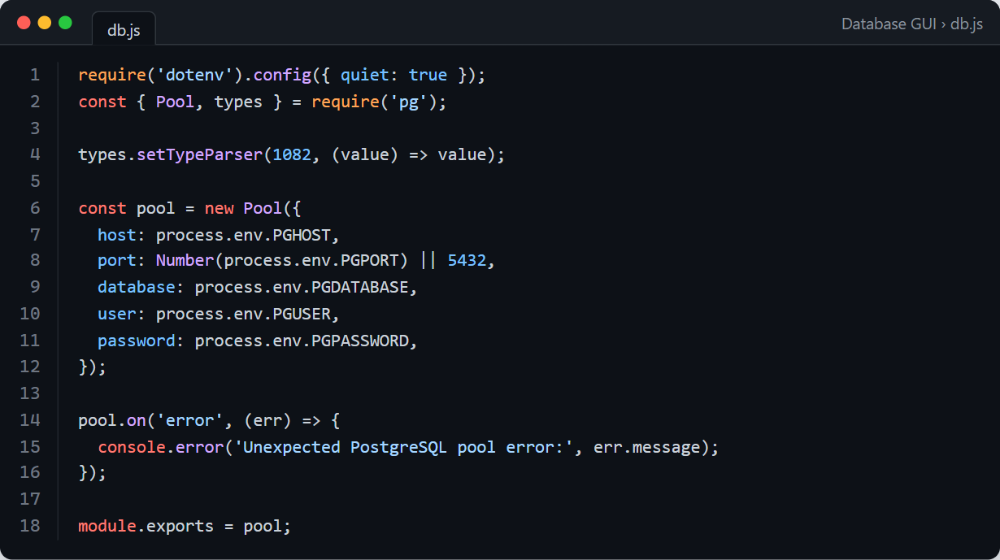
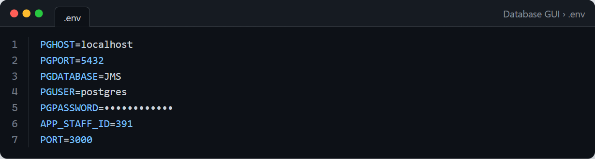
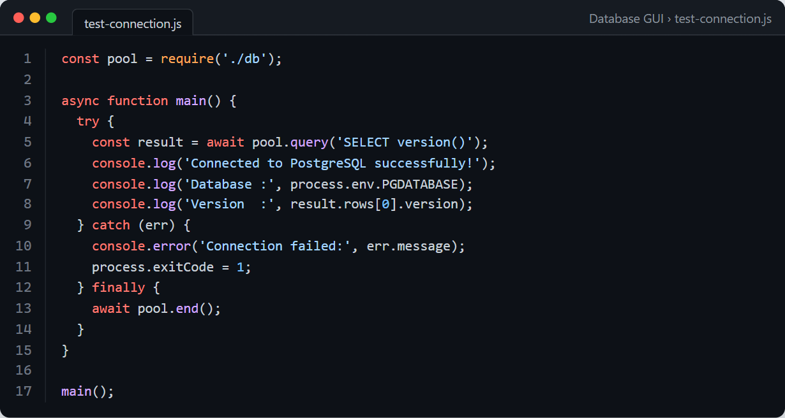
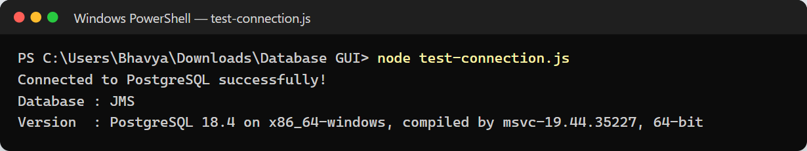
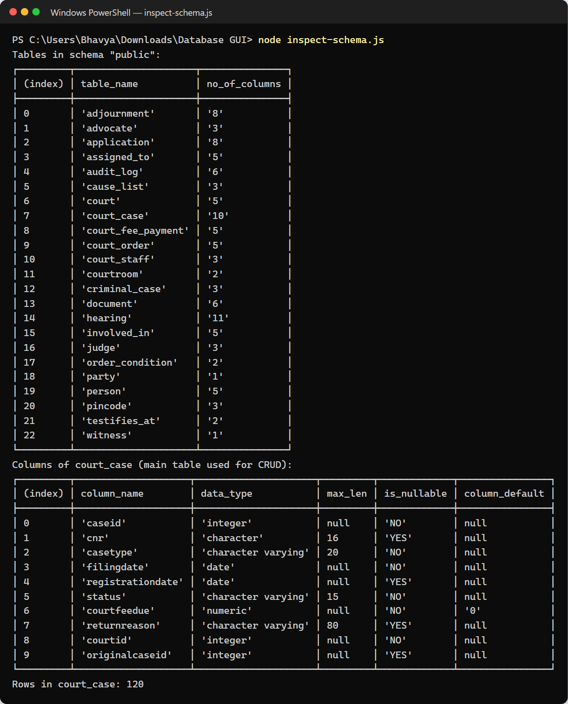

---

## (B) CRUD Operation Code

### 1. CREATE (INSERT)

| Item | What to include |
|---|---|
| **SQL** | `INSERT INTO court_case (caseid, cnr, casetype, filingdate, registrationdate, status, courtfeedue, returnreason, courtid, originalcaseid) VALUES ((SELECT COALESCE(MAX(caseid), 0) + 1 FROM court_case), $1, $2, $3, $4, $5, $6, $7, $8, $9) RETURNING *` |
| **Function** | Express route `POST /api/cases`: validates input, then `pool.query(INSERT_SQL, values)` ([B1_CREATE_sql_and_function.png](B1_CREATE_sql_and_function.png)) |
| **Output** | Console: `[CREATE] INSERT INTO court_case -> result.rowCount = 1` / `Case 121 inserted successfully.` · psql shows the new row |

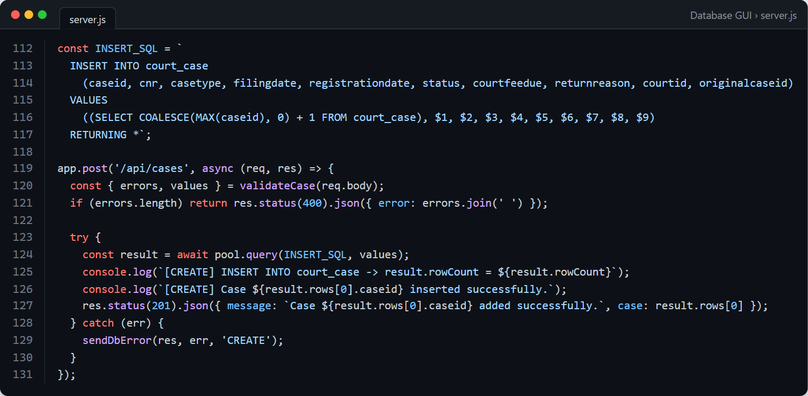
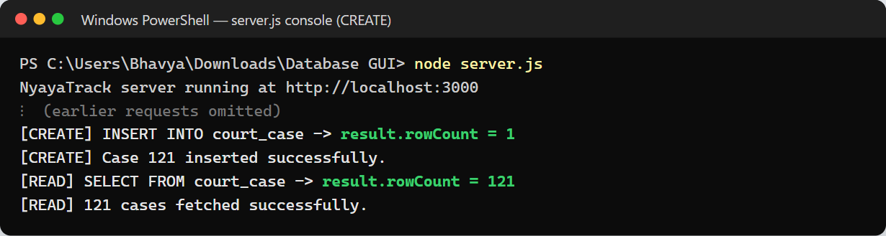
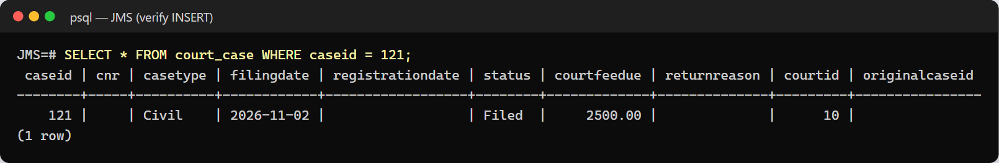

### 2. READ (SELECT)

| Item | What to include |
|---|---|
| **SQL** | `SELECT c.caseid, c.cnr, c.casetype, c.filingdate, c.registrationdate, c.status, c.courtfeedue, c.returnreason, c.courtid, ct.courtname, c.originalcaseid FROM court_case c JOIN court ct ON ct.courtid = c.courtid WHERE ($1::varchar IS NULL OR c.casetype = $1::varchar) AND ($2::varchar IS NULL OR c.status = $2::varchar) AND ($3::text IS NULL OR ($3::text = 'due' AND c.courtfeedue > 0) OR ($3::text = 'none' AND c.courtfeedue = 0)) AND ($4::date IS NULL OR (CASE WHEN $6::text = 'registration' THEN c.registrationdate ELSE c.filingdate END) >= $4::date) AND ($5::date IS NULL OR (CASE WHEN $6::text = 'registration' THEN c.registrationdate ELSE c.filingdate END) <= $5::date) ORDER BY c.caseid DESC` |
| **Function** | Express route `GET /api/cases`: one fixed statement; a filter left on "All" is passed as `NULL` and switches itself off ([B2_READ_sql_and_function.png](B2_READ_sql_and_function.png)) |
| **Output** | Console: `result.rowCount = 120` for all cases and `= 3` for *Criminal + Hearing + Fee due + registered in 2026* · psql returns the same counts and rows |

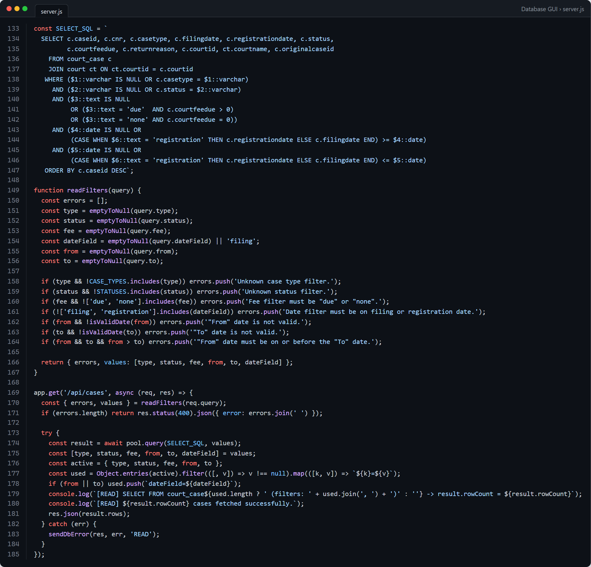
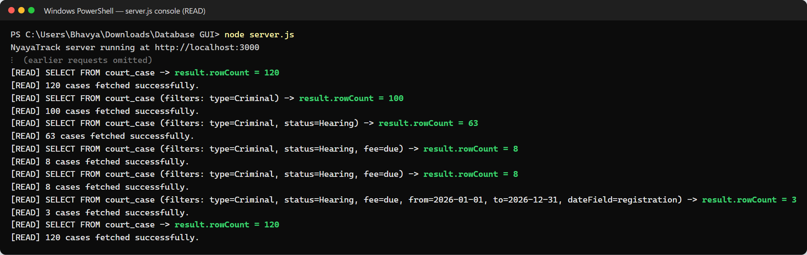
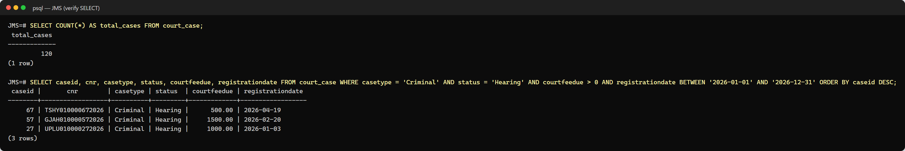

### 3. UPDATE

| Item | What to include |
|---|---|
| **SQL** | `UPDATE court_case SET cnr = $1, casetype = $2, filingdate = $3, registrationdate = $4, status = $5, courtfeedue = $6, returnreason = $7, courtid = $8, originalcaseid = $9 WHERE caseid = $10 RETURNING *` |
| **Function** | Express route `PUT /api/cases/:id`: inside a transaction, `set_config('nyaya.staffid', $1, true)` (for our audit trigger), then the UPDATE, then `COMMIT` ([B3_UPDATE_sql_and_function.png](B3_UPDATE_sql_and_function.png)) |
| **Output** | Console: `[UPDATE] UPDATE court_case WHERE caseid = 121 -> result.rowCount = 1` · psql shows case 121 now *Registered* with CNR, and the `AUDIT_LOG` row written by trigger `trg_audit_case_status` |

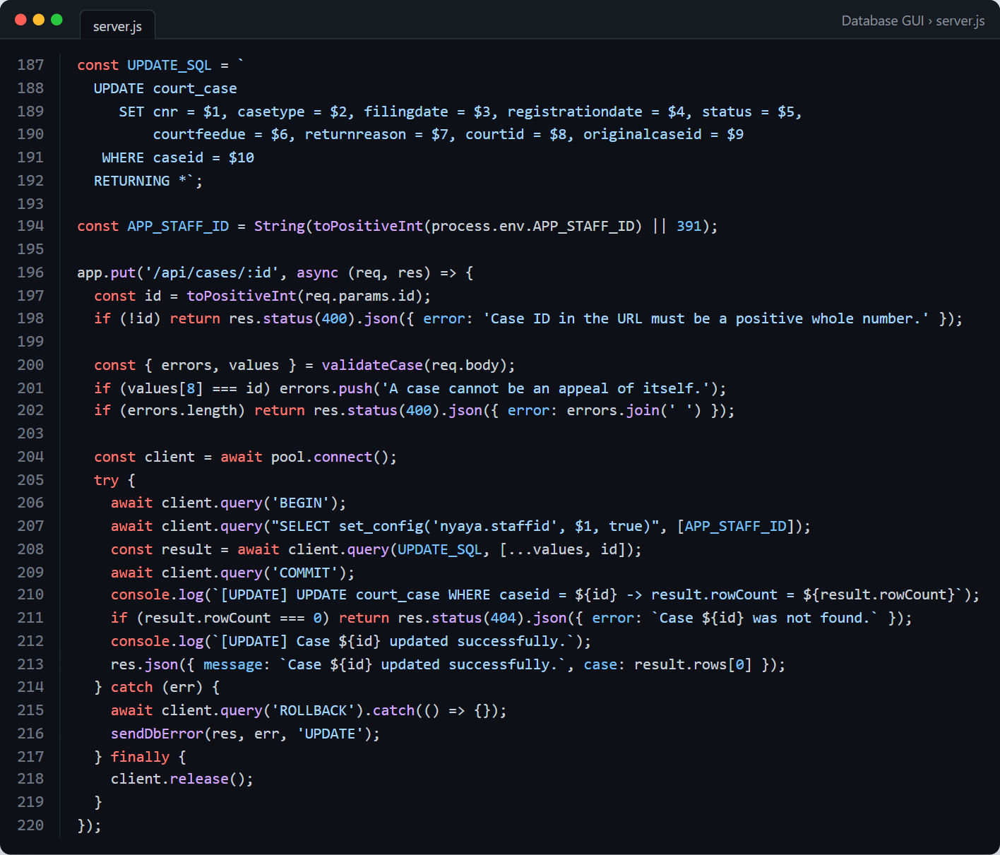
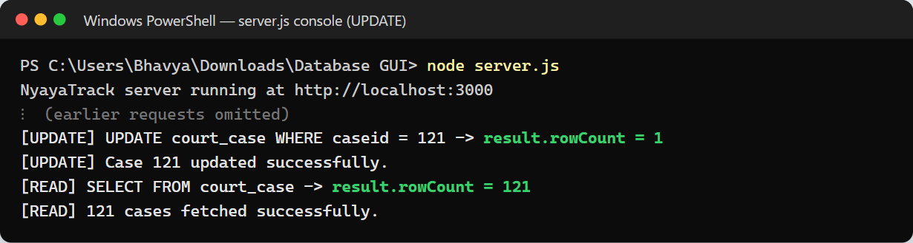
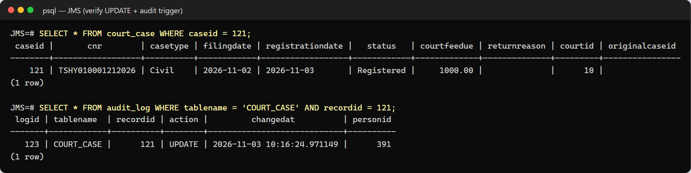

### 4. DELETE

| Item | What to include |
|---|---|
| **SQL** | `DELETE FROM court_case WHERE caseid = $1` |
| **Function** | Express route `DELETE /api/cases/:id` ([B4_DELETE_sql_and_function.png](B4_DELETE_sql_and_function.png)) |
| **Output** | Console: `[DELETE] DELETE FROM court_case WHERE caseid = 121 -> result.rowCount = 1` · psql: `(0 rows)` for case 121 and the total back to 120. Deleting case 1 is refused by the database (`23001`, foreign keys with `ON DELETE RESTRICT`) |

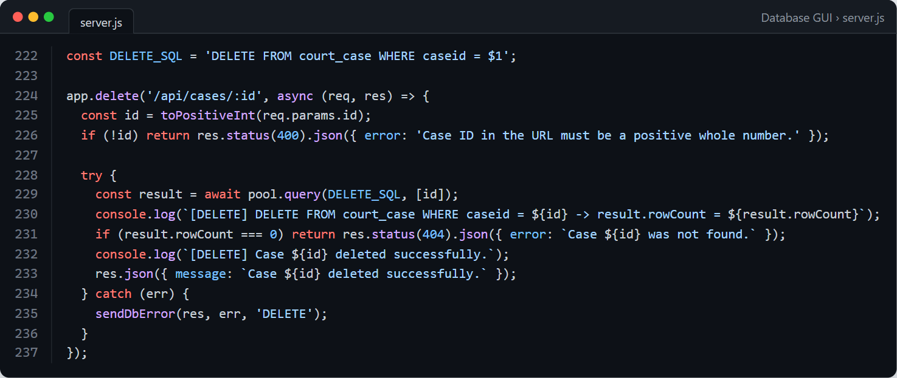
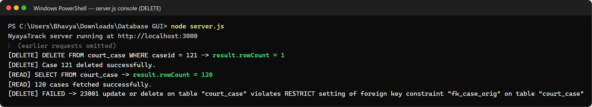
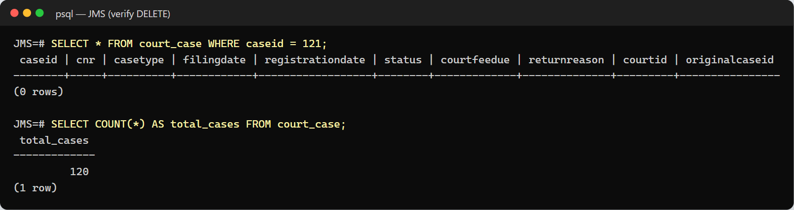

**Extra: input validation and error messages** ([B5_input_validation_and_error_messages.png](B5_input_validation_and_error_messages.png)). The server checks every field against the same rules as our CHECK constraints. It also turns PostgreSQL error codes (`23505`, `23503`, `23001`, `23514`, `P0001`, …) into readable messages.

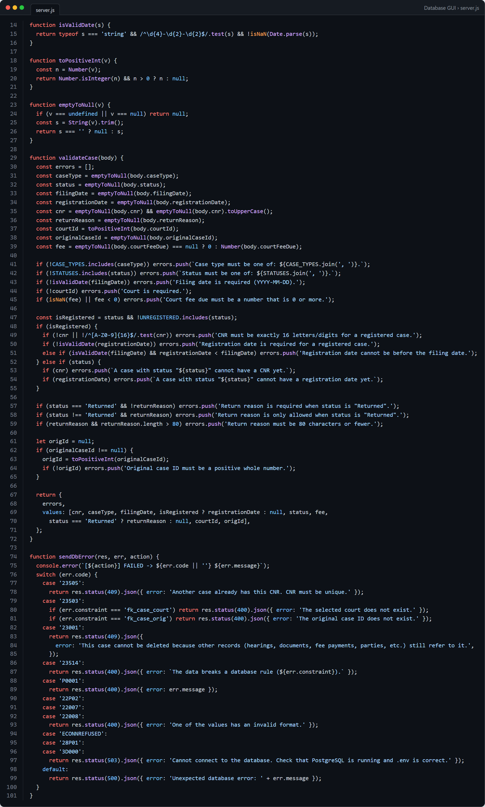

---

## (C) Frontend Screenshots

Every action below changed the real `COURT_CASE` table, as the B-section console and psql output shows.

| # | Screenshot | What it shows |
|---|---|---|
| C01 | [C01_add_new_case_form.png](C01_add_new_case_form.png) | "Add new case" form filled in (dropdowns for type, status, court) |
| C02 | [C02_case_added_success_new_row_highlighted.png](C02_case_added_success_new_row_highlighted.png) | "Case 121 added successfully." with the new row highlighted in the table |
| C03 | [C03_records_table_all_cases.png](C03_records_table_all_cases.png) | Table of all 120 cases with Edit / Delete buttons per row |
| C04 | [C04_filters_select_type_status_fee_period.png](C04_filters_select_type_status_fee_period.png) | Dropdown filters: case type, status, fee due, filing / registration period |
| C05 | [C05_edit_case_form_selected_row.png](C05_edit_case_form_selected_row.png) | Row 121 selected with **Edit**: the form switches to "Edit case #121" with status, CNR, date and fee changed |
| C06 | [C06_case_updated_success.png](C06_case_updated_success.png) | "Case 121 updated successfully." with the updated row in the table |
| C07 | [C07_delete_confirmation_dialog.png](C07_delete_confirmation_dialog.png) | Delete confirmation dialog |
| C08 | [C08_case_deleted_success.png](C08_case_deleted_success.png) | "Case 121 deleted successfully." with the row gone |
| C09 | [C09_delete_blocked_by_foreign_keys.png](C09_delete_blocked_by_foreign_keys.png) | Deleting case 1 refused because hearings, documents and appeals still refer to it |
| C10 | [C10_dark_mode.png](C10_dark_mode.png) | The same page in dark mode |

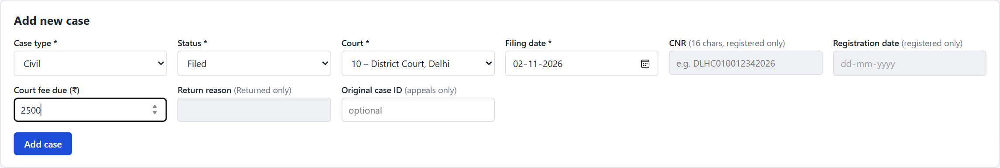
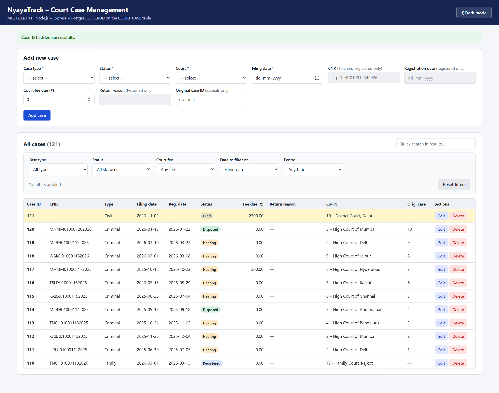
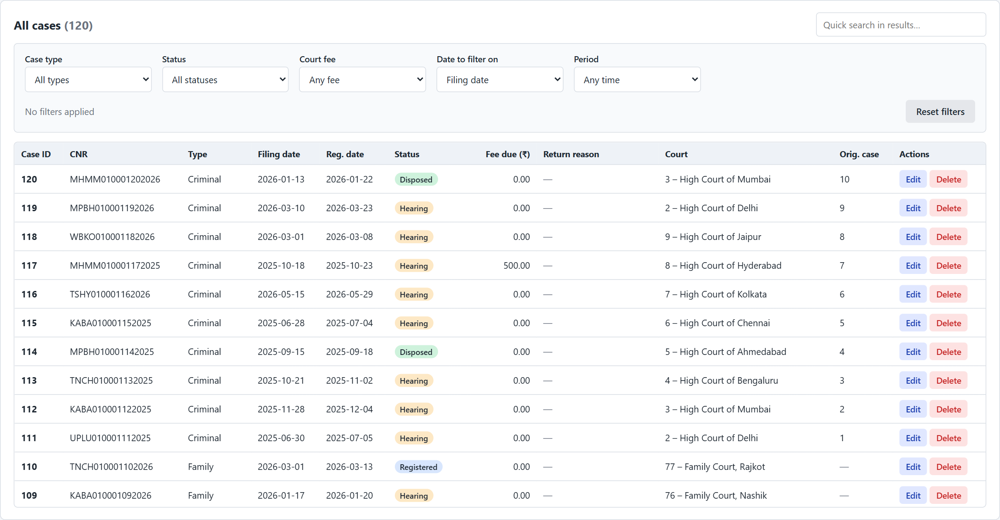
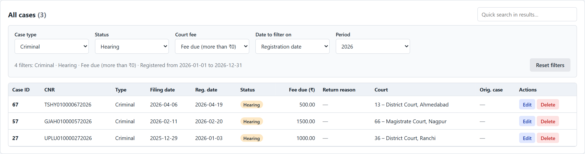
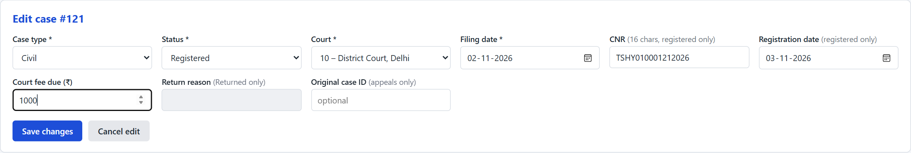
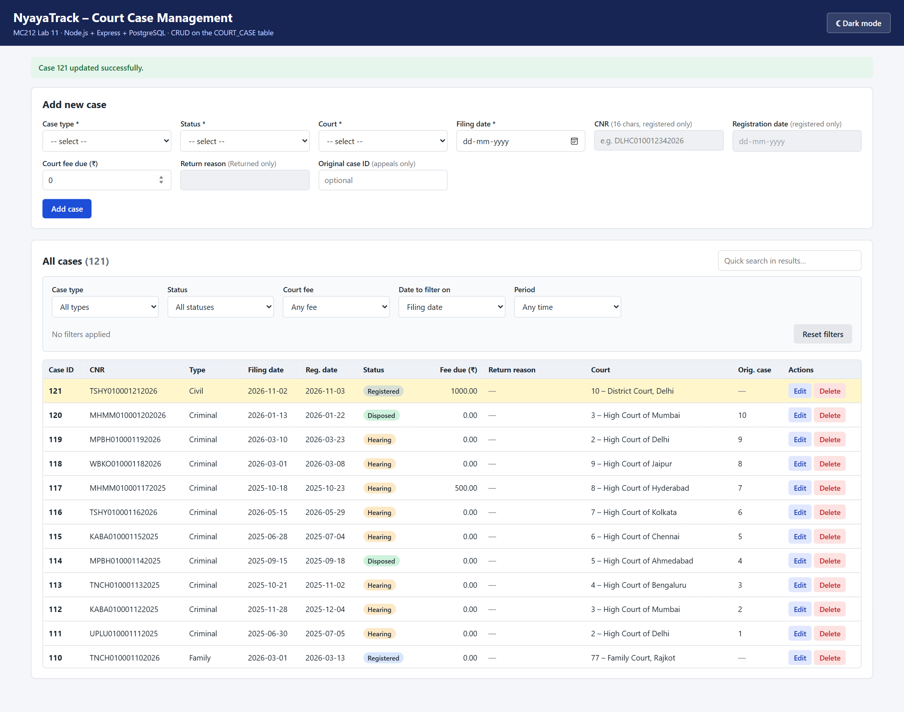
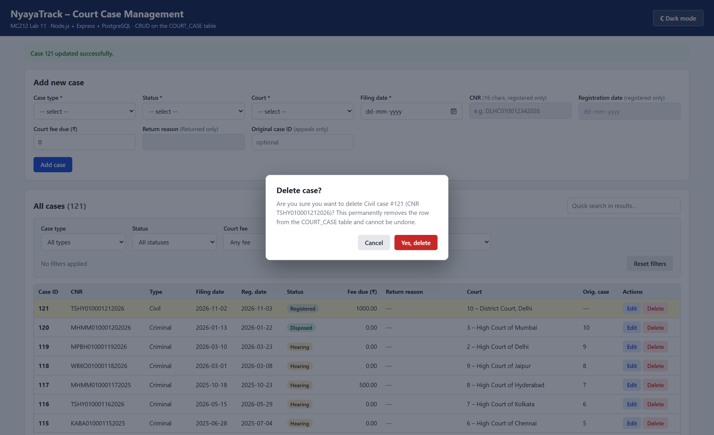
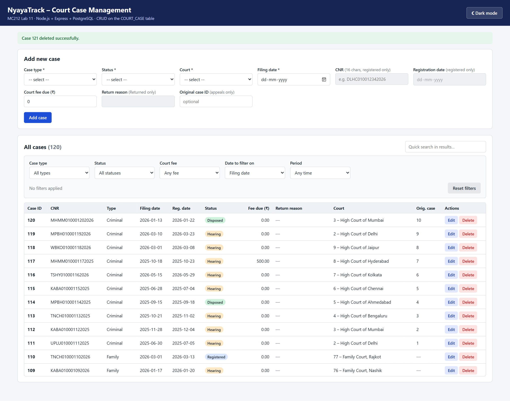
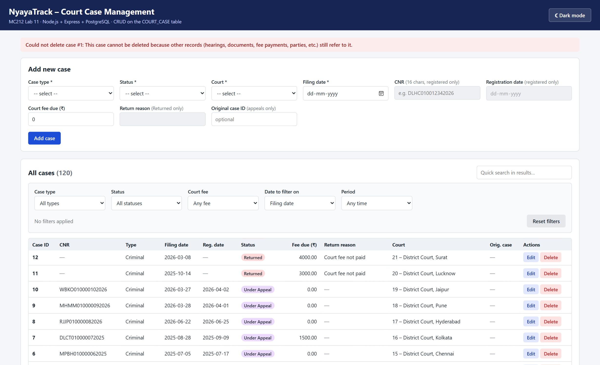
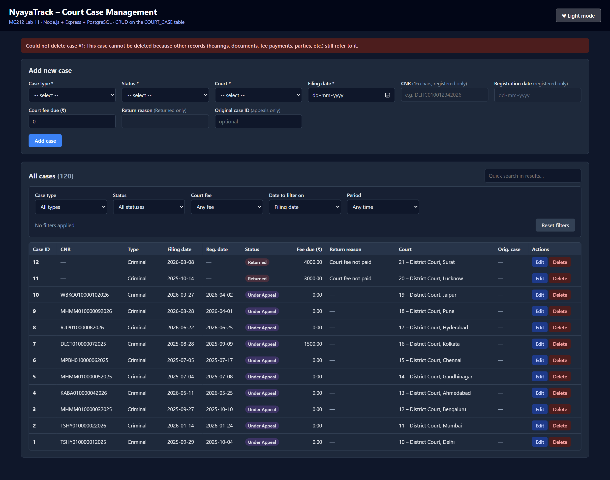

---

## (D) Reflection / Conclusion

Connecting our NyayaTrack database to a web front end looked simple, but several real problems came up. First, we did not remember the `postgres` password, so the connection test failed with *password authentication failed*; we reset it in pgAdmin with `ALTER USER` and kept the new value only in the `.env` file. Second, every UPDATE failed with *unrecognized configuration parameter "nyaya.staffid"*: a status-audit trigger from an earlier lab expects the application to say which staff member made the change. We fixed this by running the UPDATE inside a transaction that first calls `set_config('nyaya.staffid', $1, true)`. Third, deleting an existing case returned error `23001` because hearings, documents and appeals still reference it through `ON DELETE RESTRICT` foreign keys, so we translated database error codes into clear messages for the user. We also had to compute the next CaseID ourselves because the column is not SERIAL, and return DATE columns as text to avoid timezone shifts.

We learned that every user value must reach PostgreSQL through `$1, $2 …` placeholders, never string concatenation, to prevent SQL injection; that credentials belong in `.env`, excluded by `.gitignore` and hidden in screenshots; and that input must be validated on the server even when the form already checks it. Most importantly, the browser must never connect to PostgreSQL directly: that would expose the password and let anyone run any SQL, so the Express API is the only gatekeeper between the UI and the database.

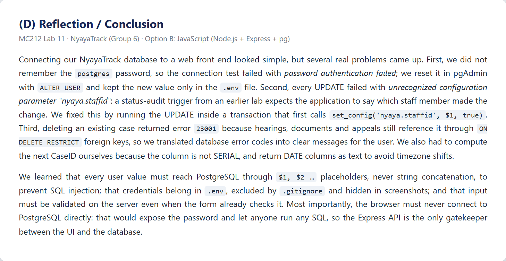
